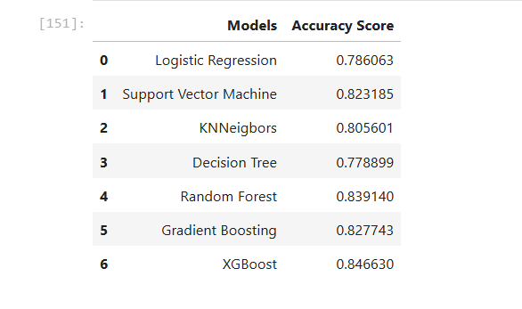
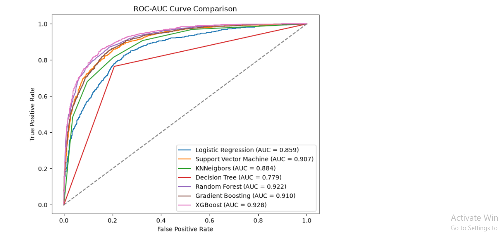

# Customer Churn Prediction

## 📌 Project Overview

This project focuses on predicting whether a bank customer is likely to **churn** using Machine Learning.

Customer churn prediction helps businesses identify customers who may leave their services. By predicting churn in advance, businesses can take appropriate actions to improve customer retention.

---

## 🎯 Objective

The main objective of this project is to build and compare multiple Machine Learning classification models to predict customer churn and identify the best-performing model.

---

## 📊 Dataset

The dataset contains information about bank customers, including features such as:

- Credit score
- Age
- Balance
- Number of products
- Credit card status
- Active membership
- Other customer-related information

### Target Variable

- `churn`
  - `0` → Customer did not churn
  - `1` → Customer churned

---

## 🔍 Project Workflow

The project follows the following Machine Learning workflow:

1. Data Loading
2. Exploratory Data Analysis (EDA)
3. Checking Missing Values
4. Outlier Detection and Handling
5. Data Visualization
6. Encoding Categorical Features
7. Handling Imbalanced Data using SMOTE
8. Feature Scaling
9. Train-Test Split
10. Model Training
11. Model Evaluation
12. Model Comparison
13. ROC-AUC Curve Analysis

---

## 📈 Exploratory Data Analysis

The dataset was analyzed using:

- `head()`
- `shape`
- `info()`
- `describe()`
- Missing value analysis
- Target variable distribution
- Feature distribution analysis

Visualizations were also used to better understand the relationship between important features and customer churn.

---

## ⚠️ Outlier Handling

Outliers in the **Age** feature were identified using the **Interquartile Range (IQR)** method.

The following formula was used:

- Lower Bound = Q1 − 1.5 × IQR
- Upper Bound = Q3 + 1.5 × IQR

Outlier records were handled before training the Machine Learning models.

---

## ⚖️ Handling Imbalanced Data

The target variable was imbalanced.

To address this problem, **SMOTE (Synthetic Minority Over-sampling Technique)** was used to balance the classes.

```python
sm = SMOTE()
x_res, y_res = sm.fit_resample(x, y)
```

---

## 🤖 Machine Learning Models

The following classification algorithms were trained and evaluated:

| Model | Description |
|---|---|
| Logistic Regression | Baseline linear classification model |
| Support Vector Machine | Classification using optimal decision boundaries |
| K-Nearest Neighbors | Classification based on nearby data points |
| Decision Tree | Tree-based classification model |
| Random Forest | Ensemble of multiple decision trees |
| Gradient Boosting | Sequential boosting algorithm |
| XGBoost | Advanced gradient boosting algorithm |

---

## 📊 Model Evaluation

The models were evaluated using:

- Accuracy Score
- Precision
- Recall
- F1-Score
- Classification Report
- ROC Curve
- AUC Score

---

## 📉 ROC-AUC Curve

ROC-AUC curves were generated to compare the performance of all classification models.

The ROC curve shows the relationship between:

- **False Positive Rate**
- **True Positive Rate**

The **AUC (Area Under the Curve)** helps measure the overall ability of a model to distinguish between customers who churn and those who do not churn.

---

## 🏆 Result

Multiple Machine Learning models were compared based on their performance.

Based on the project analysis, **XGBoost performed as the best model for this customer churn prediction task**.

---

## 🛠️ Technologies Used

- Python
- Pandas
- NumPy
- Matplotlib
- Seaborn
- Scikit-learn
- Imbalanced-learn
- XGBoost
- Jupyter Notebook

---
## Model Accuracy


---
## ROC-AUC Curve


---


## 👤 Author

**Afzar M**

Aspiring Data Scientist / AI Engineer

---
